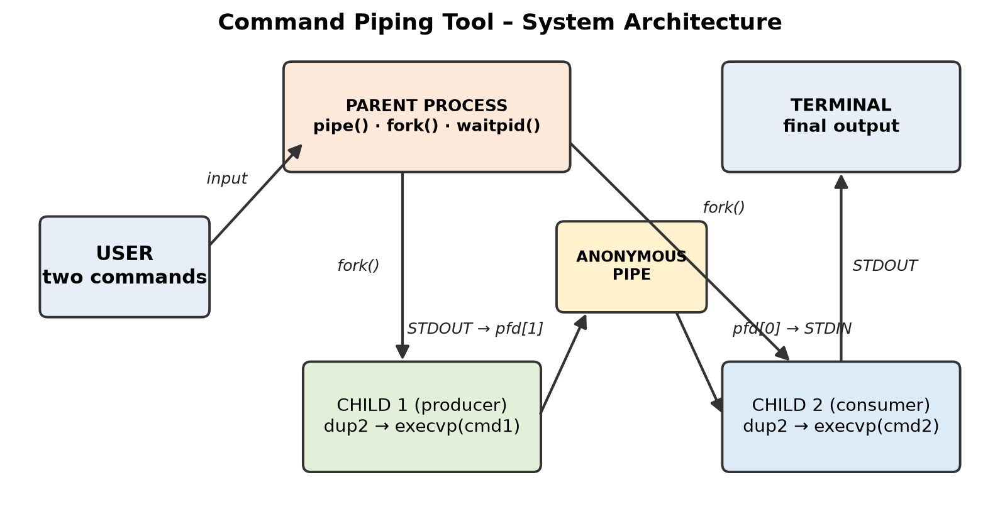
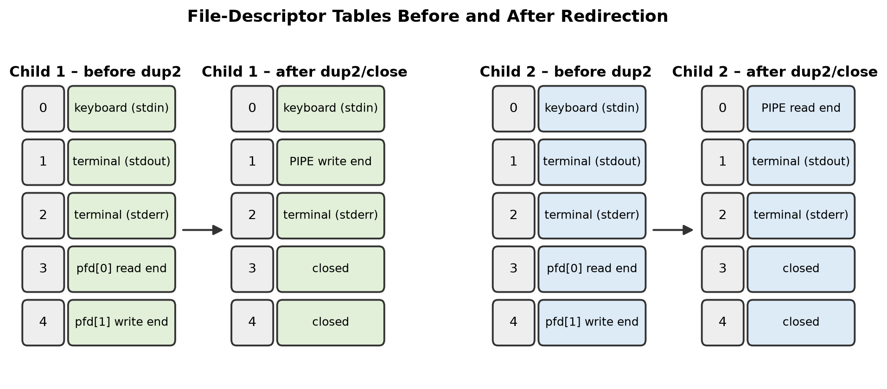
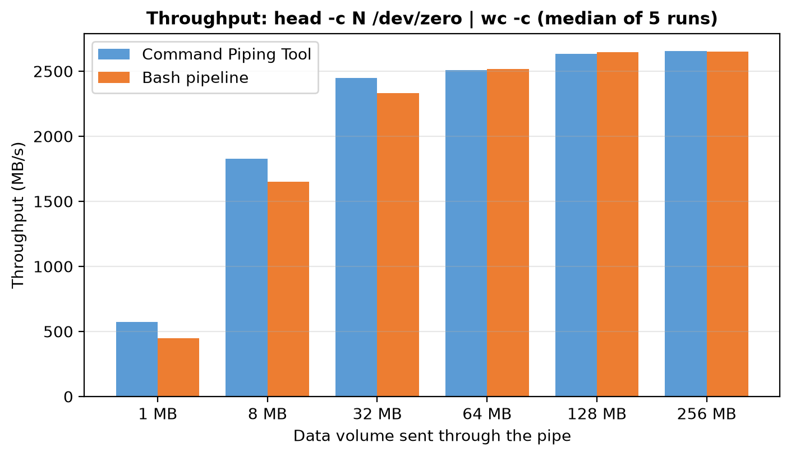

# Command Piping Tool

A C program that rebuilds a two-command shell pipeline (`cmd1 | cmd2`) from scratch using POSIX system calls: `pipe()`, `fork()`, `dup2()`, `close()`, `execvp()` and `waitpid()`.

**Course:** Operating Systems and System Programming (25CS2104E), Project Based Learning
**Institution:** KL University (KLH), Aziz Nagar, Hyderabad
**Faculty guide:** Dr. A. Seenu

| Roll number | Name |
|---|---|
| 2510030145 | Ivaturi Naga Mohith |
| 2510030115 | Peddi Indra Kiran Reddy |
| 2510030200 | CH Harshith |

---

## How it works



1. The parent reads Command 1 and Command 2. Text inside quotes is kept as one argument.
2. `pipe(pfd)` creates the anonymous pipe. `pfd[0]` is the read end and `pfd[1]` is the write end.
3. **Child 1 (producer):** `dup2(pfd[1], STDOUT_FILENO)`, then `execvp(cmd1)`.
4. **Child 2 (consumer):** `dup2(pfd[0], STDIN_FILENO)`, then `execvp(cmd2)`.
5. Every unused pipe end is closed, so Command 2 gets EOF when Command 1 finishes.
6. The parent calls `waitpid()` on both children. It reports each exit status, or the signal that killed the child (for example SIGPIPE).



## Build and run

```bash
make            # or: gcc -Wall -O2 -o pipetool src/pipetool.c
./pipetool
```

```text
===== COMMAND PIPING TOOL =====
Command 1: echo "hello operating system"
Command 2: tr a-z A-Z
...
Final output:
HELLO OPERATING SYSTEM

[parent] child 1 (pid ...) exited with status 0
[parent] child 2 (pid ...) exited with status 0
```

## Tests

`make test` runs 10 pipelines through the tool and through Bash, then compares the output.

| Test | Pipeline | What it checks |
|---|---|---|
| T1 | `ls -l \| grep .c` | Filtering |
| T2 | `cat /etc/passwd \| wc -l` | Counting (depends on EOF) |
| T3 | `echo "hello operating system" \| tr a-z A-Z` | Transformation, quoted argument |
| T4 | `lsx -l \| wc -l` | Invalid first command (exit 127) |
| T5 | `ls \| sort -r` | Sorting a stream |
| T6 | `seq 1 100000 \| tail -n 3` | Multi-write data |
| T7 | `head -c 1048576 /dev/zero \| wc -c` | Data larger than the 64 KiB pipe buffer |
| T8 | `printf "banana\napple\ncherry\napple\n" \| sort -u` | Escaped quoted argument |
| T9 | `ls -l \| grepx foo` | Invalid second command |
| T10 | `seq 1 1000000 \| head -n 2` | Early consumer exit, so the producer gets SIGPIPE |

All 10 tests pass.

## Experiments

- **Benchmark** (`benchmarks/bench.py`): sends 1 MB to 256 MB through the pipe. Throughput levels off around 2.6 GB/s, about the same as Bash.
- **Descriptor leak** (`experiments/pipetool_bug.c`): here the parent never closes the pipe, so `wc -l` waits for EOF forever. Run `make pipetool_bug && timeout 5 ./pipetool_bug` to see it.



## Repository layout

```text
src/pipetool.c                  the tool
experiments/pipetool_bug.c      descriptor-leak variant
tests/run_tests.sh              10 tests compared against Bash
benchmarks/                     throughput benchmark and results
docs/                           PBL documentation (PDF and DOCX) and figures
presentations/                  review presentations
```

## References

- W. R. Stevens and S. A. Rago, *Advanced Programming in the UNIX Environment*, 3rd ed., 2013.
- M. Kerrisk, *The Linux Programming Interface*, 2010.
- Linux man-pages: pipe(2), fork(2), dup(2), execvp(3), wait(2), pipe(7).
